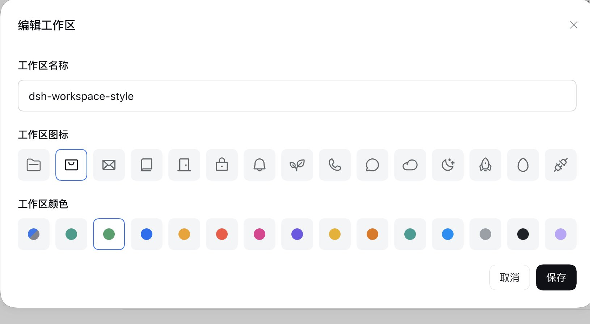

<p align="center">
  
</p>

<h1 align="center">dsh-workspace-style</h1>

<p align="center"><b>Give every workspace in the DeepSeek Harness sidebar its own icon and color: one Edit dialog for the name, icon and color, with distinct glyphs for collapsed, expanded and active states.</b></p>

<p align="center">
  <a href="README.md">中文</a> ·
  <a href="#features">Features</a> ·
  <a href="#install">Install</a> ·
  <a href="#usage">Usage</a> ·
  <a href="#persistence-and-limits">Persistence</a> ·
  <a href="docs/DEVELOPING.md">Development docs</a>
</p>

<p align="center">
  <a href="https://www.npmjs.com/package/dsh-workspace-style"></a>
  <a href="https://www.npmjs.com/package/dsh-workspace-style"></a>
  <a href="LICENSE"></a>
  <a href="https://github.com/moonmoonCL/dsh-workspace-style/stargazers"></a>
</p>

Every workspace in the DSH sidebar wears the same folder glyph. This plugin gives each one its own icon and color: the row menu's "Rename" becomes "Edit", and a single dialog edits the name, the icon and the color together.

> A browser-side DSH plugin (client plugin). It never touches the Host's Workspace records and adds no Remote method; the appearance lives in the browser's `localStorage`, keyed by the stable Workspace id.

## Features

- **Menu: Edit** — the workspace row's "Rename" item becomes "Edit" and opens the unified dialog.
- **System-default choices** — the first icon tile is "default (system) icon" (the native folder, both states intact) and the first color tile is "follow system" (gray at rest, blue while the workspace holds the current session — the built-in selection logic). The two axes are independent: change only the icon, only the color, or reset both.
- **One edit dialog** — name, icon (1 default + 14 pictorial) and color (1 follow-system + 14 swatches) saved in one go; both tile rows hold the same number of tiles, so the dialog's two edges line up.
- **Three-state icons** — every pictorial icon mirrors the built-in folder's full state model: **collapsed** shows the collapsed outline, **expanded** swaps to the expanded outline, and while the workspace **holds the current session** it swaps to a filled silhouette with a hollow (20% opacity) interior. Hovering a dialog tile previews the filled form.
- **Instant in the sidebar** — saving repaints the row's glyph immediately; "default icon + custom color" only tints the native folder, keeping both states and the built-in blue-active look.
- **Name validation** — same as the built-in rename: an empty name disables Save and a duplicate is reported locally; without rename permission the name is read-only while the appearance still saves.
- **Cross-tab sync** — other tabs on the same origin update through the `storage` event.
- **Localized** — built-in Chinese and English copy, following DSH's current language.

## Install

The plugin ships as a DSH bundle: `dsh.bundle.patch` in the manifest inserts the `dsh-workspace-style` Host entry, and `dsh.client` declares the browser entry.

```sh
# From npm (recommended)
dsh plugin --profile web add dsh-workspace-style

# Or install straight from GitHub, without npm
dsh plugin --profile web add github:moonmoonCL/dsh-workspace-style
```

Replace `--profile web` with the profile you actually use (`desktop`, `dsh-tui`, …). DSH's plugin manager can also install and enable this bundle. Reload the DSH page afterwards; no Host restart is needed.

### Installing from a local checkout

To run it as a local package in a DSH profile (say `~/.dsh/profiles/web`):

1. Link the package into the profile's dependencies (`pnpm add link:/path/to/dsh-workspace-style`, or add it to `package.json` and run `pnpm install`).
2. Add `dsh-workspace-style` to the profile's `dsh.profile.bundles`.
3. Reload the DSH web page; the plugin loads through the client module graph, no Host restart needed.

## Usage

1. Find any workspace in the sidebar, hover it and click the "⋯" button.
2. Choose **Edit**.
3. Change the name, pick an icon and a color, then click **Save**.

## Persistence and limits

- The appearance lives in this browser's `localStorage` (key `dsh-workspace-style:styles:v1`), keyed by Workspace id, and is never written to the Host database. An entry is `{icon, color}`, where `null` on an axis means "system default" for it; a both-default entry is deleted (so resetting really removes the saved style).
- A Workspace therefore does **not** sync across browsers or DSH web ports, and clearing site data loses the appearance.
- Workspace rows are rendered by `@deepseek-ai/dsh-client-ui-workspace`; this plugin decorates them through the stable `data-row-key="workspace:<id>"` attribute. If DSH renames that attribute, decoration stops working and nothing else breaks.
- ui-workspace registers the built-in "Rename" item and another plugin cannot unregister it, so this plugin hides that item — only inside a menu that also holds its own "Edit" item, matched by the current language's label.
- Icon geometry comes from [Phosphor Icons](https://phosphoricons.com) (MIT): the regular weight for the outline forms, the duotone weight for the filled active form, drawn through a CSS mask in the sidebar. The "follow system" color inherits the built-in gray/blue logic; a chosen color is a fixed hex, the same in light and dark themes.
- The built-in folder's open/closed states and blue-active coloring stay native; the catalog's `folder` mirror uses the host's own geometry, has no filled variant, and so keeps the same look as "system default".

## Development

```
package.json          plugin manifest (dsh.bundle + dsh.client)
cordis.patch.yml      the bundle's Host entry
index.js              host half (stateless)
client.js             browser half: menu, dialog, persistence, row decoration
screenshots.json      marketplace detail-page screenshots
docs/assets/          screenshots and artwork
locale/{zh,en}.json   marketplace display copy
```

There is no build step: `client.js` registers itself through `window.__ModuleLoader__.load({ id, factory })`, the same module system the built-in client plugins use.

```sh
node --check client.js
node --test test/*.test.mjs
```

## License

MIT
